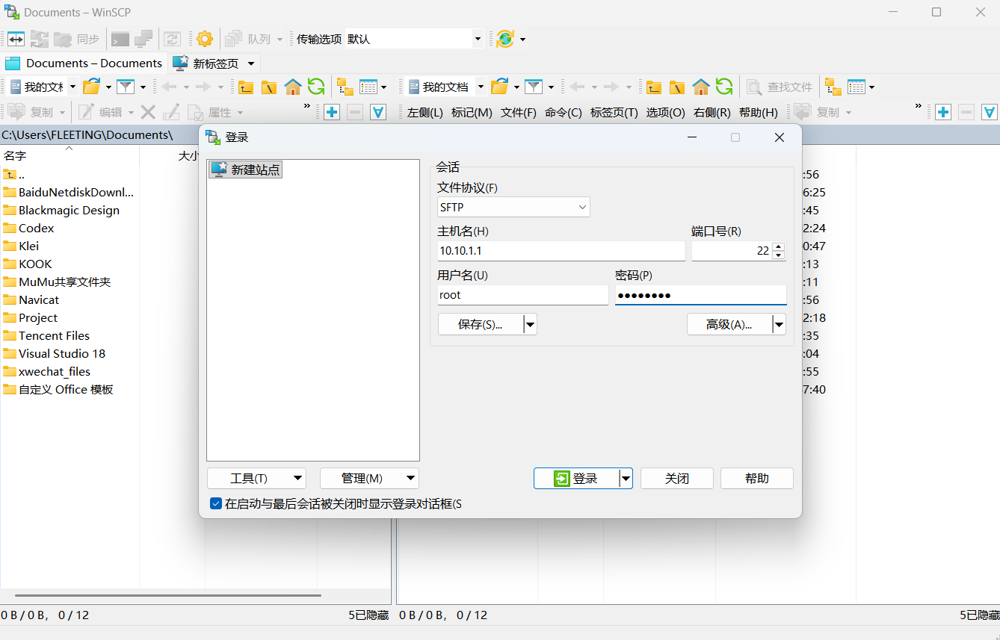
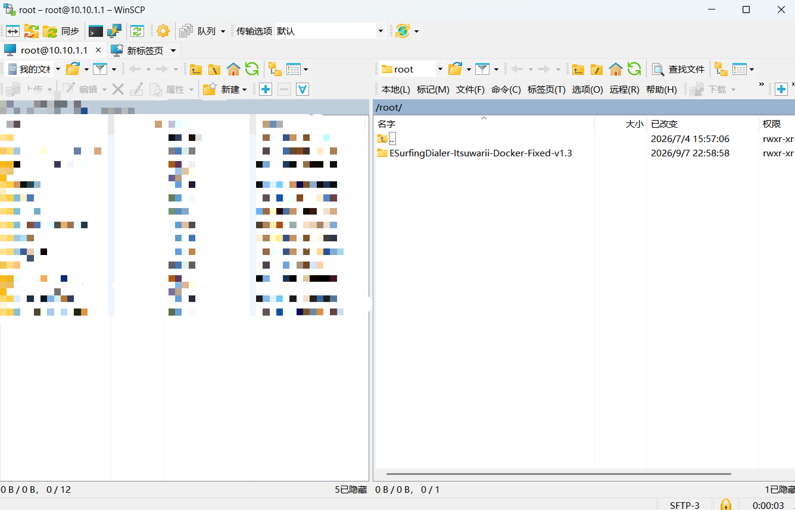
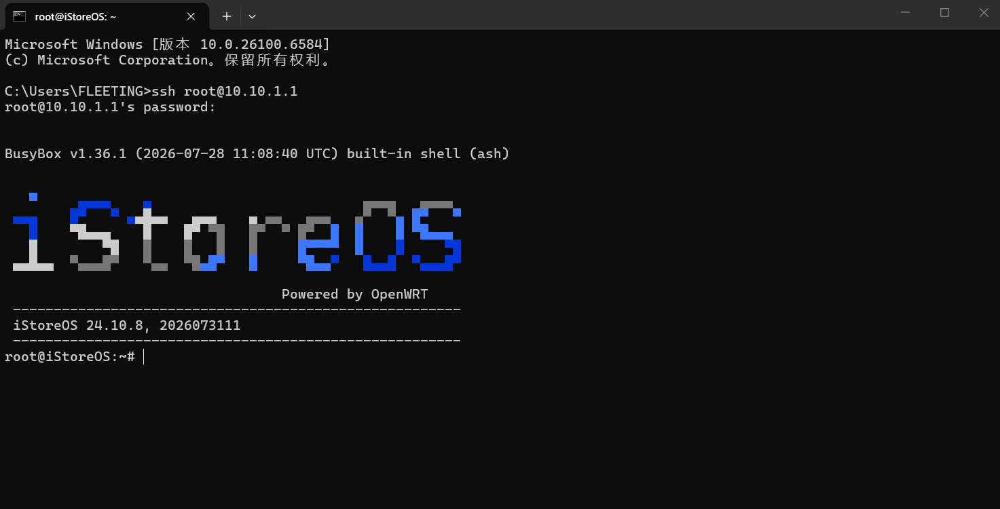
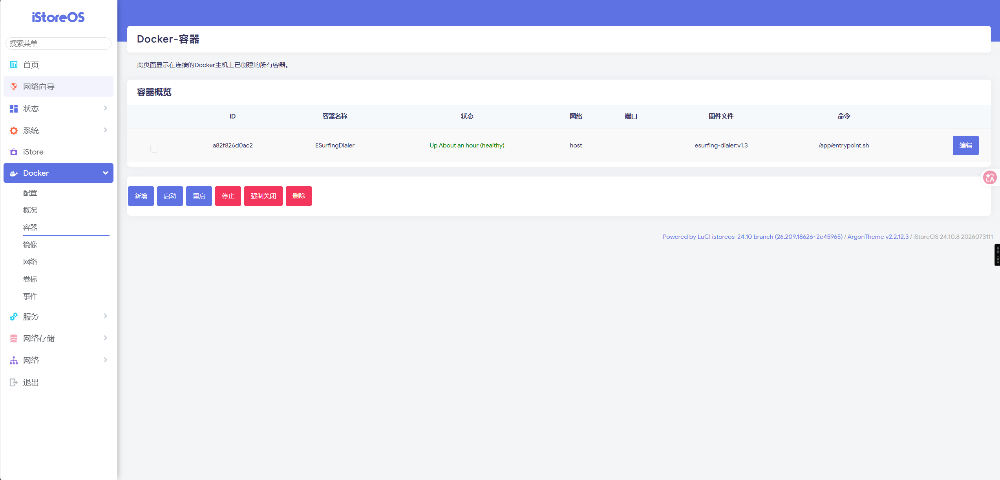
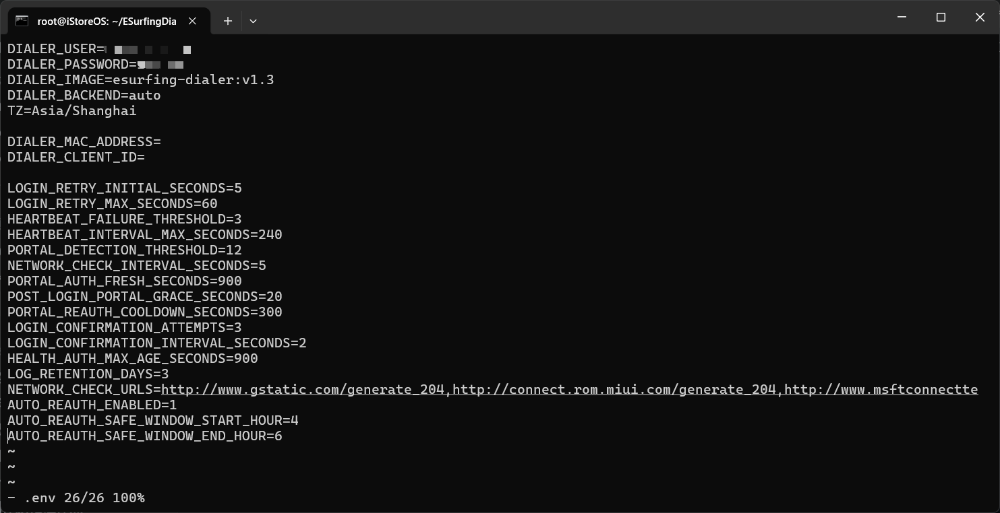

# ESurfingDialer Docker v2.4 离线部署教程

适用环境：已经安装 Docker 和 Docker Compose 的 OpenWrt / iStoreOS 软路由。

本教程只使用离线部署包。软路由不需要访问 Docker Hub、GitHub、Gradle 或 Maven；只需要在电脑上提前下载压缩包，再通过局域网上传到软路由。

当前正式附件为 `ESurfingDialer-Docker-v2.4.zip`，从[v2.4 发布页面](https://github.com/FLEETING-XHX/ESurfingDialer/releases/tag/v2.4)下载 **Docker ZIP 附件**，不要选择页面自动生成的源码压缩包。仅支持 **amd64 / x86_64**，至少留出 1 GB 空间。

流程是：上传 ZIP → SSH 登录 → 解压 → 安装并填写账号 → 停止旧认证程序 → 启动新版 → 查看日志。v2.4 安装脚本只创建容器，**不会自动启动认证**。

下面截图来自旧版本，用于说明操作位置；目录、镜像和容器名称以正文中的 v2.4 命令为准。已有旧版本的用户先看文末“从旧版本迁移”，再安装新版。

## 第一步：安装 OpenWrt 或 iStoreOS

如果软路由还没有安装系统，请先参考下面的视频完成 OpenWrt / iStoreOS 的安装：

[OpenWrt / iStoreOS 安装教程（哔哩哔哩）](https://www.bilibili.com/video/BV1w541157Uo/)

完成系统安装后，请先确认软路由可以正常进入管理页面，并且已经安装 Docker 和 Docker Compose 插件，再继续下面的步骤。

## 第二步：使用 WinSCP 上传离线包

### 2.1 下载并打开 WinSCP

在电脑上下载并安装 WinSCP。打开后选择：

- 文件协议：`SFTP`
- 主机名：软路由的 IP 地址
- 端口号：`22`
- 用户名：`root`
- 密码：软路由的 root 密码



点击“登录”。第一次连接时如果出现主机密钥提示，确认 IP 地址无误后接受即可。

### 2.2 选择上传目录

登录成功后，右侧是软路由文件目录。WinSCP 默认通常会进入：

```text
/root
```



推荐直接使用 `/root` 目录：

1. 在电脑左侧找到下载好的 `ESurfingDialer-Docker-v2.4.zip`。
2. 确认右侧当前目录是 `/root`。
3. 将压缩包直接拖到右侧窗口，等待上传完成。

也可以使用 `/mnt`、`/opt`，或自行创建目录，但新手更推荐 `/root`。`/mnt` 和 `/opt` 可能涉及挂载存储、权限或目录不存在等额外问题，容易导致后面的命令找不到文件。

上传完成后，右侧应能看到：

```text
/root/ESurfingDialer-Docker-v2.4.zip
```

## 第三步：使用 Windows CMD 连接软路由终端

在 Windows 电脑上按 `Win + R`，输入：

```text
cmd
```

按回车打开命令提示符，然后输入下面的命令。请把 IP 地址替换成自己的软路由 IP：

```cmd
ssh root@10.10.1.1
```

第一次连接可能会询问是否信任主机，输入：

```text
yes
```

然后输入软路由 root 密码。输入密码时屏幕不会显示字符，这是正常现象，输入完成后直接按回车即可。

登录成功后，终端通常默认就在 `/root` 目录下。可以输入下面的命令确认当前目录：

```sh
pwd
```

如果显示 `/root`，说明已经在正确目录。此时再输入 `cd /root` 看起来没有变化也是正常的，因为当前本来就在 `/root`。



## 第四步：解压离线部署包

先确认压缩包存在：

```sh
ls -lh ESurfingDialer-Docker-v2.4.zip
```

使用 `unzip` 解压：

```sh
unzip ESurfingDialer-Docker-v2.4.zip
```

如果提示没有 `unzip` 命令，先在软路由的软件包管理页面安装 `unzip`。这只是在安装解压工具，不是下载 Docker 镜像。

进入解压后的目录：

```sh
cd /root/ESurfingDialer-Docker-v2.4
ls -lh
```

确认目录中有 `install.sh`、`start.sh`、`docker-compose.yml`、`.env.example` 和 `images`，再校验包内文件：

```sh
sha256sum -c SHA256SUMS
```

如果校验失败，请重新上传或下载完整 ZIP，不继续安装。

## 第五步：离线安装并填写账号

在刚才解压的目录运行：

```sh
sh install.sh
```

脚本会检查 Docker、Docker Compose、CPU 架构和可用空间，导入包内镜像，询问校园网账号密码，生成 `.env` 和 `data`，并创建 `ESurfingDialer-v2.4` 容器。**安装完成后容器尚未启动**，此时没有开始认证。

输入校园网密码时屏幕不会显示字符，输入完成后按回车。交互输入直接填写原始密码，脚本会处理特殊字符。已有 `.env` 时安装器保留账号密码和已配置的重认证设置，补充缺失配置并更新镜像标签。

如果提示容器已经存在，不要删除配置或重复安装，按文末“已有 v2.4：更新或修改配置”操作。

## 第六步：启动认证

先停止电脑上或软路由上运行的旧天翼校园认证程序、旧 Docker 容器。可以在 Docker 网页管理界面停止旧容器，也可以先查看名称：

```sh
docker ps --format '{{.Names}}'
```

例如旧正式版容器名为 `ESurfingDialer`，停止命令是：

```sh
docker stop -t 60 ESurfingDialer
```

按实际名称操作；若还有 beta 容器或外部 watchdog/定时任务，确认它们不会重新启动旧认证程序。然后在 v2.4 目录运行：

```sh
sh start.sh
```

启动脚本会检查约定名称的旧版本是否仍在运行，使用本地镜像启动新版，不从公网拉取镜像。不要同时启动两个认证版本。

### 使用软路由网页界面

运行 `sh install.sh` 后，Docker 网页管理界面中会出现 `ESurfingDialer-v2.4`。首次启动推荐执行上面的 `sh start.sh`；如果通过网页按钮启动，必须自行确认其他认证版本全部停止。



网页管理页用于管理容器，程序本身没有账号配置网页。修改账号需编辑部署目录中的 `.env`，再按下方步骤应用配置。

## 第七步：查看认证结果

```sh
docker ps -a --filter name=ESurfingDialer-v2.4
docker logs --tail 100 ESurfingDialer-v2.4
cat data/health.json
ls -lh data/logs
```

日志出现 `LOGIN_CONFIRMED` / `LOGIN_SUCCESS` 表示登录已通过心跳确认；再用连接此软路由的电脑打开网页，确认实际可以上网。只有容器显示“运行中”不代表认证成功。

默认 INFO 级别下，周期心跳成功会定期输出 `HEARTBEAT_SUMMARY`，失败记录 `HEARTBEAT_FAILED`，失败后的首次恢复记录 `HEARTBEAT_RECOVERED`。没有逐次 `HEARTBEAT_SUCCESS` 不等于心跳停止。

## 手动修改账号或重认证设置

在 v2.4 部署目录编辑 `.env`：

```sh
vi .env
```

至少填写：

```dotenv
DIALER_USER="你的校园网账号"
DIALER_PASSWORD="你的校园网密码"
AUTO_REAUTH_ENABLED=1
AUTO_REAUTH_SAFE_WINDOW_START_HOUR=4
AUTO_REAUTH_SAFE_WINDOW_END_HOUR=6
```

手动编辑双引号内的凭据时，`$` 写成 `$$`，反斜线 `\` 写成 `\\`，双引号 `"` 写成 `\"`；空格、单引号和 `#` 保留在双引号内。例如实际密码 `ab$cd` 写成 `DIALER_PASSWORD="ab$$cd"`。交互安装时直接输入原值，不输入手工转义后的值。



图片仅展示配置位置。`DIALER_IMAGE` 保持本包的 `esurfing-dialer:v2.4`。按 `i` 编辑，完成后按 `Esc`，输入 `:wq` 并回车保存。确认其他认证版本停止，再运行 `sh start.sh` 应用配置；只点击网页“重启”不会应用新的环境变量。

`AUTO_REAUTH_ENABLED=1` 开启周期学习和安全窗口重认证，`0` 关闭主动计划，仍保留心跳及掉线恢复。默认安全窗口为 UTC+8 的每天 4:00–6:00，实际周期取决于学校和采样结果。

## 停止与再次启动

在 v2.4 目录执行：

```sh
# 停止，保留容器与数据
docker compose --project-name esurfing-dialer-v24 stop
# 再次启动
sh start.sh
```

不要执行 `docker compose down -v`、`docker system prune -a`，也不要删除 `data/device-state.json`。`data` 保存设备身份、认证计划、健康状态与日志。

## 从旧版本迁移

1. 备份旧部署目录的 `.env` 和整个 `data` 目录，备份包含账户和设备信息，请妥善保存。
2. 将 v2.4 ZIP 解压到新目录，保留旧目录、旧镜像和旧容器。
3. 停止旧认证容器及可能自动启动它的宿主任务，确认旧进程已停止，再将备份的 `.env` 和 `data` 复制到新的 v2.4 目录。
4. 在 v2.4 目录运行 `sh install.sh`。安装器保留已有凭据和重认证设置，只更新镜像标签、补缺失配置；手工填写过的特殊密码需按上面的格式核对。
5. 运行 `sh start.sh`，检查日志、健康状态和实际上网。

v2.4 使用独立容器名，不需要为了迁移删除旧容器。切回旧版时，先停止 `ESurfingDialer-v2.4`，再启动旧容器；两个版本交替运行。不要将仍在写入的 `data` 直接复制给另一运行中的版本。

## 已有 v2.4：更新或修改配置

保留原 v2.4 目录中的 `.env` 和 `data`。更新包时停止该容器、将新的交付文件解压到原目录，校验文件并导入包内新镜像，再重建：

```sh
docker compose --project-name esurfing-dialer-v24 stop
sha256sum -c SHA256SUMS
gzip -dc images/esurfing-dialer-v2.4-amd64.tar.gz | docker load
sh start.sh --force-recreate
docker logs --tail 100 ESurfingDialer-v2.4
```

执行前确认其他认证容器也已停止。只修改 `.env` 时不必重新导入镜像，运行 `sh start.sh` 即可。

## 常见问题

| 现象 | 检查方法 |
| --- | --- |
| 找不到 ZIP 或 `install.sh` | 用 `pwd`、`ls -lh` 确认上传和解压目录，命令中的路径与实际位置一致 |
| 提示 Docker / Compose 不可用 | 先在软路由管理页安装并启用 Docker 与 Docker Compose，分别检查 `docker info`、`docker compose version` |
| 提示架构不支持 | 执行 `uname -m`；当前离线包只支持 x86_64 / amd64，不支持 arm64 |
| 安装后没有上网 | 安装只创建容器，停止旧认证程序后运行 `sh start.sh`，再检查登录日志 |
| 提示旧认证容器仍在运行 | 查看 `docker ps`，停止提示中的旧容器，同时检查宿主定时任务 |
| 提示 v2.4 容器已经存在 | 保留 `.env` 和 `data`，使用已有 v2.4 的更新步骤，不重复运行安装器 |
| 登录失败或容器反复退出 | 查看日志中的首个失败阶段，核对账号及手动凭据转义，反馈版本、时间、步骤和脱敏日志 |

## 版本与验证范围

v2.4 汇入门户兼容、会话恢复、健康监督、计划重认证、日志限额和 10-10 审查修复。离线镜像沿用已校验的 v1.3 amd64 Java 17 / Alpine 环境，追加当前程序和运行脚本；来源与摘要见包内 `BUILDINFO.json`、`SHA256SUMS`。

此前 beta3 已完成一次真实登录、确认心跳和上网；v2.4 的真实恢复、注销、软路由部署矩阵与长期稳定仍待验收。离线回归、包内容和 Compose 配置检查不代替实际 Docker 导入/启动与长期验证，v1.3 的 14 天记录属于历史版本。

历史 beta 的独立部署与切换方式见[beta3 测试说明](历史版本/Docker-beta3测试说明.md)。版本更新与剩余工作见[修复与优化总记录](../../修复与优化总记录.md)。反馈不要公开账号、密码、票据、密钥、设备身份或原始 ZSM。
