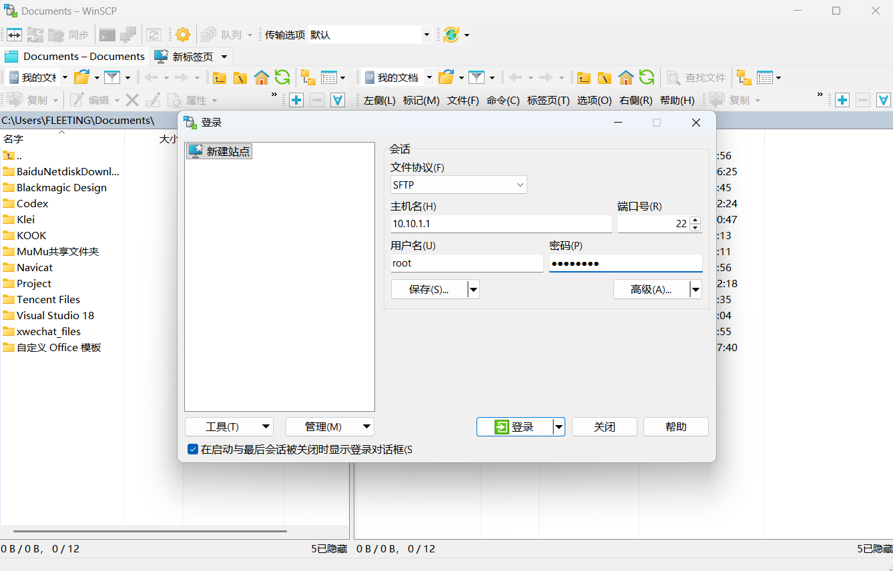
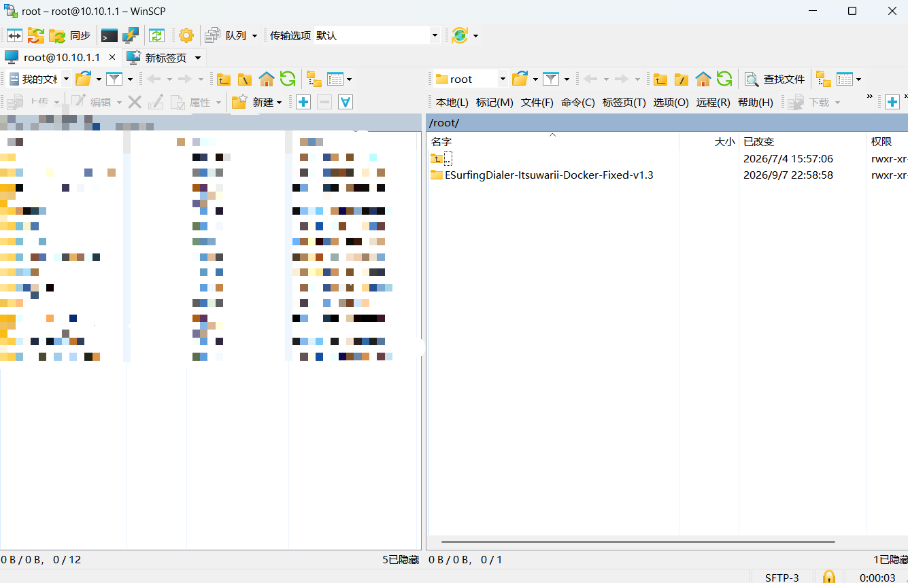
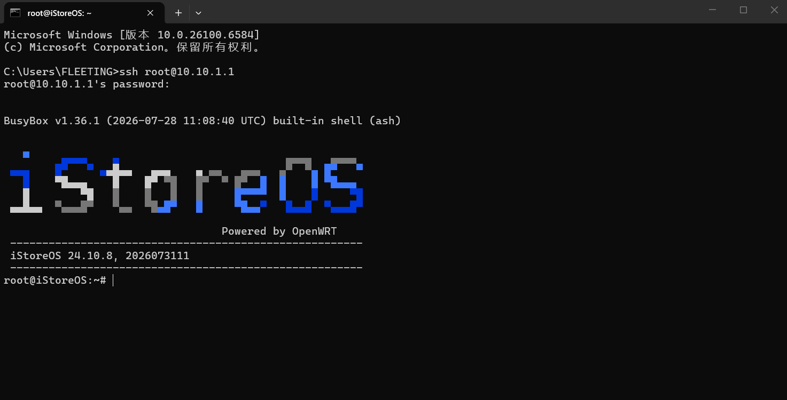
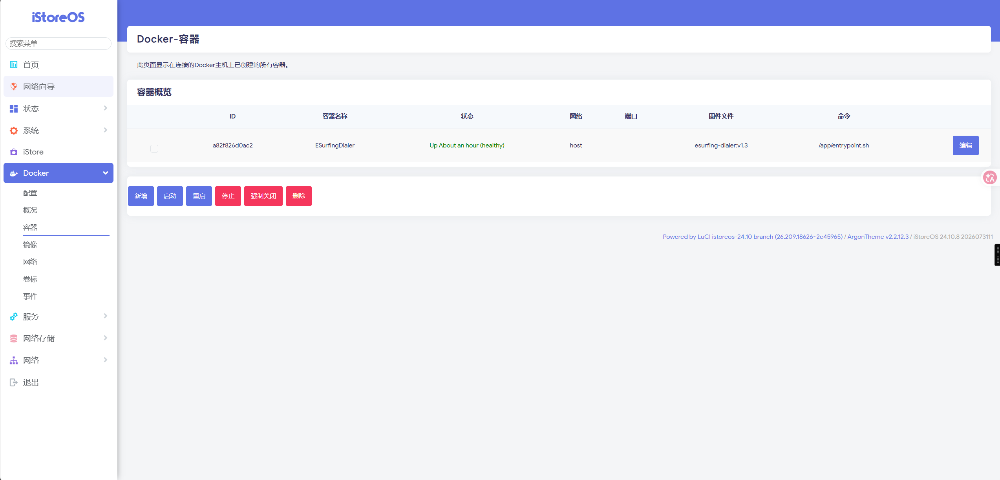
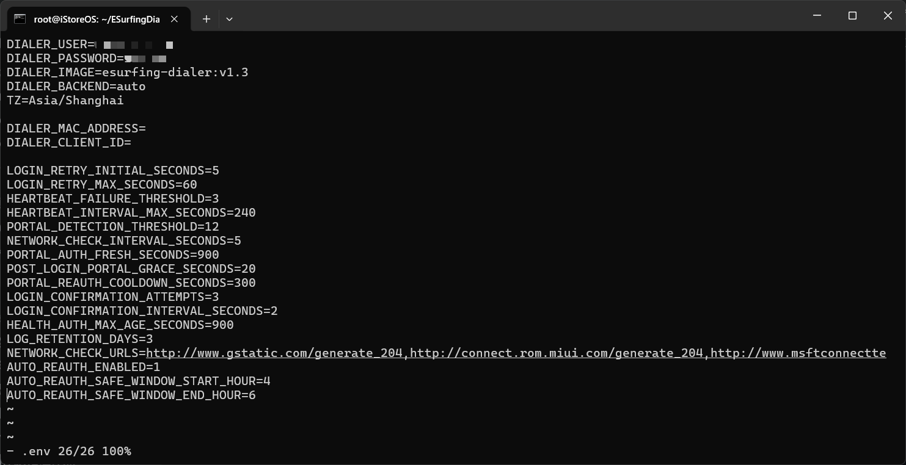

# ESurfingDialer Docker v2.4 离线部署教程

适用环境：已经安装 Docker 和 Docker Compose 的 OpenWrt / iStoreOS 软路由。

本教程只使用离线部署包。软路由不需要访问 Docker Hub、GitHub、Gradle 或 Maven；只需要在电脑上提前下载压缩包，再通过局域网上传到软路由。

当前正式附件为 `ESurfingDialer-Docker-v2.4.zip`，从[v2.4 发布页面](https://github.com/FLEETING-XHX/ESurfingDialer/releases/tag/v2.4)下载 **Docker ZIP 附件**，不要选择页面自动生成的源码压缩包。仅支持 **amd64 / x86_64**，至少留出 1 GB 空间。

流程是：上传 ZIP → SSH 登录 → 解压 → 安装并填写账号 → 停止旧认证程序 → 启动新版 → 查看日志。v2.4 安装脚本只创建容器，**不会自动启动认证**。

下面截图来自旧版本，用于说明操作位置；目录、镜像和容器名称以正文中的 v2.4 命令为准。首次部署按第一步到第七步操作；已经安装过的用户先看后面的“更新”。本文适用于 Kotlin Docker v2.4 离线包，不适用于 Docker C++ v3.0.0 实验包。

## 第一步：安装 OpenWrt 或 iStoreOS

如果软路由还没有安装系统，请先参考下面的视频完成 OpenWrt / iStoreOS 的安装：

[OpenWrt / iStoreOS 安装教程（哔哩哔哩）](https://www.bilibili.com/video/BV1w541157Uo/)

完成系统安装后，请先确认软路由可以正常进入管理页面，并且已经安装 Docker 和 Docker Compose 插件，再继续下面的步骤。

## 第二步：使用 WinSCP 上传离线包

### 2.1 下载并打开 WinSCP

在电脑上下载并安装 WinSCP。打开后选择：

- 文件协议：`SFTP`
- 主机名：软路由的 IP 地址
- 端口号：`22`
- 用户名：`root`
- 密码：软路由的 root 密码



点击“登录”。第一次连接时如果出现主机密钥提示，确认 IP 地址无误后接受即可。

### 2.2 选择上传目录

登录成功后，右侧是软路由文件目录。WinSCP 默认通常会进入：

```text
/root
```



推荐直接使用 `/root` 目录：

1. 在电脑左侧找到下载好的 `ESurfingDialer-Docker-v2.4.zip`。
2. 确认右侧当前目录是 `/root`。
3. 将压缩包直接拖到右侧窗口，等待上传完成。

也可以使用 `/mnt`、`/opt`，或自行创建目录，但新手更推荐 `/root`。`/mnt` 和 `/opt` 可能涉及挂载存储、权限或目录不存在等额外问题，容易导致后面的命令找不到文件。

上传完成后，右侧应能看到：

```text
/root/ESurfingDialer-Docker-v2.4.zip
```

## 第三步：使用 Windows CMD 连接软路由终端

在 Windows 电脑上按 `Win + R`，输入：

```text
cmd
```

按回车打开命令提示符，然后输入下面的命令。请把 IP 地址替换成自己的软路由 IP：

```cmd
ssh root@10.10.1.1
```

第一次连接可能会询问是否信任主机，输入：

```text
yes
```

然后输入软路由 root 密码。输入密码时屏幕不会显示字符，这是正常现象，输入完成后直接按回车即可。

登录成功后，终端通常默认就在 `/root` 目录下。可以输入下面的命令确认当前目录：

```sh
pwd
```

如果显示 `/root`，说明已经在正确目录。此时再输入 `cd /root` 看起来没有变化也是正常的，因为当前本来就在 `/root`。



## 第四步：解压离线部署包

先确认压缩包存在：

```sh
ls -lh ESurfingDialer-Docker-v2.4.zip
```

使用 `unzip` 解压：

```sh
unzip ESurfingDialer-Docker-v2.4.zip
```

如果提示没有 `unzip` 命令，先在软路由的软件包管理页面安装 `unzip`。这只是在安装解压工具，不是下载 Docker 镜像。

进入解压后的目录：

```sh
cd /root/ESurfingDialer-Docker-v2.4
ls -lh
```

确认目录中有 `install.sh`、`start.sh`、`docker-compose.yml`、`.env.example` 和 `images`，再校验包内文件：

```sh
sha256sum -c SHA256SUMS
```

如果校验失败，请重新上传或下载完整 ZIP，不继续安装。

## 第五步：离线安装并填写账号

在刚才解压的目录运行：

```sh
sh install.sh
```

脚本会检查 Docker、Docker Compose、CPU 架构和可用空间，导入包内镜像，询问校园网账号密码，生成 `.env` 和 `data`，并创建 `ESurfingDialer-v2.4` 容器。**安装完成后容器尚未启动**，此时没有开始认证。

输入校园网密码时屏幕不会显示字符，输入完成后按回车。交互输入直接填写原始密码，脚本会处理特殊字符。已有 `.env` 时安装器保留账号密码和已配置的重认证设置，补充缺失配置并更新镜像标签。

如果提示容器已经存在，不要删除配置或重复安装，按后面的“更新”操作。只是想先部署、暂不认证，到这里就可以停下；文末也提供了只创建容器的命令。

## 第六步：启动认证

先停止电脑上或软路由上运行的旧天翼校园认证程序、旧 Docker 容器。可以在 Docker 网页管理界面停止旧容器，也可以先查看名称：

```sh
docker ps --format '{{.Names}}'
```

例如旧正式版容器名为 `ESurfingDialer`，停止命令是：

```sh
docker stop -t 60 ESurfingDialer
```

按实际名称操作；若还有 beta 容器或外部 watchdog/定时任务，确认它们不会重新启动旧认证程序。然后在 v2.4 目录运行：

```sh
sh start.sh
```

启动脚本会检查约定名称的旧版本是否仍在运行，使用本地镜像启动新版，不从公网拉取镜像。不要同时启动两个认证版本。

### 使用软路由网页界面

运行 `sh install.sh` 后，Docker 网页管理界面中会出现 `ESurfingDialer-v2.4`。首次启动推荐执行上面的 `sh start.sh`；如果通过网页按钮启动，必须自行确认其他认证版本全部停止。



网页管理页用于管理容器，程序本身没有账号配置网页。修改账号需编辑部署目录中的 `.env`，再按下方步骤应用配置。

## 第七步：查看认证结果

先查看最近的认证日志：

```sh
docker logs --tail 100 ESurfingDialer-v2.4
```

日志出现 `LOGIN_CONFIRMED` / `LOGIN_SUCCESS` 表示登录已通过心跳确认；再用连接此软路由的电脑打开网页，确认实际可以上网。只有容器显示“运行中”不代表认证成功。

需要持续观察时，执行 `docker logs -f --tail 100 ESurfingDialer-v2.4`；按 `Ctrl + C` 退出查看，容器仍会继续运行。

正常运行时会定期出现心跳汇总 `HEARTBEAT_SUMMARY`。`HEARTBEAT_FAILED` 表示心跳失败，`HEARTBEAT_RECOVERED` 表示失败后恢复。没有逐条输出心跳成功，不代表程序停止工作。

排查问题时，再在部署目录查看容器状态、健康记录和日志文件：

```sh
docker ps -a --filter name=ESurfingDialer-v2.4
cat data/health.json
ls -lh data/logs
```

## 手动修改账号或重认证设置

在 v2.4 部署目录编辑 `.env`：

```sh
vi .env
```

至少填写：

```dotenv
DIALER_USER="你的校园网账号"
DIALER_PASSWORD="你的校园网密码"
AUTO_REAUTH_ENABLED=1
AUTO_REAUTH_SAFE_WINDOW_START_HOUR=4
AUTO_REAUTH_SAFE_WINDOW_END_HOUR=6
```

手动编辑双引号内的凭据时，`$` 写成 `$$`，反斜线 `\` 写成 `\\`，双引号 `"` 写成 `\"`；空格、单引号和 `#` 保留在双引号内。例如实际密码 `ab$cd` 写成 `DIALER_PASSWORD="ab$$cd"`。交互安装时直接输入原值，不输入手工转义后的值。



图片仅展示配置位置。`DIALER_IMAGE` 保持本包的 `esurfing-dialer:v2.4`。使用 `vi` 时，按 `i` 开始编辑；改完按 `Esc`，输入 `:wq` 并回车保存。如果不熟悉终端编辑，也可以用 WinSCP 打开部署目录中的 `.env` 修改并保存，注意不要公开文件内容。

保存后，确认其他认证版本停止，在同一目录执行：

```sh
sh start.sh
docker logs --tail 100 ESurfingDialer-v2.4
```

这会应用新配置并启动认证。只点击网页中的“重启”，不会让容器读取修改后的环境变量。若暂时不想启动，请使用文末的“只部署容器，暂不启动”。

`AUTO_REAUTH_ENABLED=1` 开启周期学习和安全窗口重认证，`0` 关闭主动重认证计划，仍保留心跳及掉线恢复。默认安全窗口为北京时间每天 4:00–6:00；这表示允许安排重认证的时间段，实际安排还取决于学校认证周期和程序采样结果。

## 停止与再次启动

在 v2.4 目录执行：

停止认证，保留容器、账号和数据：

```sh
docker compose --project-name esurfing-dialer-v24 stop
```

以后需要恢复认证时，再执行：

```sh
sh start.sh
```

不要执行 `docker compose down -v`、`docker system prune -a`，也不要删除 `data/device-state.json`。`data` 保存设备身份、认证计划、健康状态与日志。

## 更新

更新前先确认下载的是 **Docker 部署 ZIP**。本节以更新到 v2.4 为例；将来更新其他版本时，以新包自带说明中的目录、容器名和镜像文件名为准，不要只修改下面命令里的版本号。Docker v2.4.1 目前尚未打包，Docker C++ 实验包另有部署说明。

### 情况一：从较早版本更新到 v2.4

1. 上传并解压 v2.4 ZIP，使用新的部署目录，保留旧目录。
2. 停止旧认证程序、旧容器及可能自动启动它的定时任务，确认旧版本不再运行。
3. 备份旧目录中的 `.env` 和整个 `data` 目录，再将它们复制到新目录。先停止再复制，避免备份到一半时数据仍在变化；备份包含账号和设备信息，请妥善保存。
4. 进入新目录，先执行 `sha256sum -c SHA256SUMS`，确认全部通过，再运行 `sh install.sh`。安装器保留已有账号和重认证设置，更新镜像标签并补充缺失配置；此时容器只创建、不启动。
5. 准备使用新版时，运行 `sh start.sh`，再查看日志并实际打开网页确认能上网。

v2.4 使用独立容器名，更新时可以保留旧容器和旧镜像。新版出现问题时，先停止 `ESurfingDialer-v2.4`，再启动旧版本；同一时间只运行一个认证程序。

### 情况二：替换同版本的 v2.4 部署包

只有维护者提供了新的同版本包时才需要这样操作。若只是修改账号或重认证时间，使用前面的“手动修改账号或重认证设置”即可。

1. 在原 v2.4 部署目录停止容器：

   ```sh
   docker compose --project-name esurfing-dialer-v24 stop
   ```

2. 将原目录的 `.env` 和整个 `data` 备份到部署目录之外。
3. 把新包中的交付文件覆盖到原目录，保留 `.env` 和 `data`。不要用 `.env.example` 覆盖自己的 `.env`。
4. 在原部署目录依次执行下面的命令。校验全部通过后再导入镜像；任何一步报错都先停下排查：

```sh
sha256sum -c SHA256SUMS
```

```sh
gzip -dc images/esurfing-dialer-v2.4-amd64.tar.gz | docker load
```

5. 确认其他认证版本没有运行，再应用更新并启动：

```sh
sh start.sh --force-recreate
docker logs --tail 100 ESurfingDialer-v2.4
```

如果只想准备好新版、稍后再启动，不执行第 5 步，改用文末“只部署容器，暂不启动”的命令。

## 常见问题

| 现象 | 检查方法 |
| --- | --- |
| 找不到 ZIP 或 `install.sh` | 用 `pwd`、`ls -lh` 确认上传和解压目录，命令中的路径与实际位置一致 |
| 提示 Docker / Compose 不可用 | 先在软路由管理页安装并启用 Docker 与 Docker Compose，分别检查 `docker info`、`docker compose version` |
| 提示架构不支持 | 执行 `uname -m`；当前离线包只支持 x86_64 / amd64，不支持 arm64 |
| 安装后没有上网 | 安装只创建容器，停止旧认证程序后运行 `sh start.sh`，再检查登录日志 |
| 提示旧认证容器仍在运行 | 查看 `docker ps`，停止提示中的旧容器，同时检查宿主定时任务 |
| 提示 v2.4 容器已经存在 | 保留 `.env` 和 `data`，按“更新”中的对应情况操作，不重复运行安装器 |
| 登录失败或容器反复退出 | 查看日志中的首个失败阶段，核对账号及手动凭据转义，反馈版本、时间、步骤和脱敏日志 |

## 版本与验证范围

v2.4 汇入门户兼容、会话恢复、健康监督、计划重认证、日志限额和 10-10 审查修复。离线镜像沿用已校验的 v1.3 amd64 Java 17 / Alpine 环境，追加当前程序和运行脚本；来源与摘要见包内 `BUILDINFO.json`、`SHA256SUMS`。

此前 beta3 已完成一次真实登录、确认心跳和上网；v2.4 的真实恢复、注销、软路由部署矩阵与长期稳定仍待验收。离线回归、包内容和 Compose 配置检查不代替实际 Docker 导入/启动与长期验证，v1.3 的 14 天记录属于历史版本。

历史 beta 的独立部署与切换方式见[beta3 测试说明](历史版本/Docker-beta3测试说明.md)。版本更新与剩余工作见[修复与优化总记录](../../修复与优化总记录.md)。反馈不要公开账号、密码、票据、密钥、设备身份或原始 ZSM。

## 只部署容器，暂不启动

**首次安装**最简单的方法是在 v2.4 离线包目录执行 `sh install.sh`，完成账号填写后就停止操作。它已经完成镜像导入和容器创建，后续不执行 `sh start.sh` 就不会开始认证。

如果已经导入镜像、准备好 `.env` 和 `data`，只想手动创建容器，在部署目录执行：

```sh
cd /root/ESurfingDialer-Docker-v2.4
docker compose --project-name esurfing-dialer-v24 create --no-build --pull never
```

该命令只创建容器，不启动认证，也不构建或联网拉取镜像。若提示缺少镜像或 `.env`，先完成上面的安装步骤。已有同版本容器且需要强制应用更新时，先停止它，再执行：

```sh
docker compose --project-name esurfing-dialer-v24 create --force-recreate --no-build --pull never
```

查看容器状态：

```sh
docker ps -a --filter name=ESurfingDialer-v2.4
```

新创建且未启动的容器应显示 `Created`。如果显示 `Up`，说明它已经在运行。若已有运行中的容器，请先停止再执行本节命令，不要把 `create` 当作停止命令。

等到准备认证时，先确认旧认证程序都已停止，再在同一目录运行 `sh start.sh`。以上命令对应 v2.4 离线包；Docker C++ 包使用 `compose.native.yml`，请按其包内说明操作。[Docker 官方命令说明](https://docs.docker.com/reference/cli/docker/compose/create/)。
