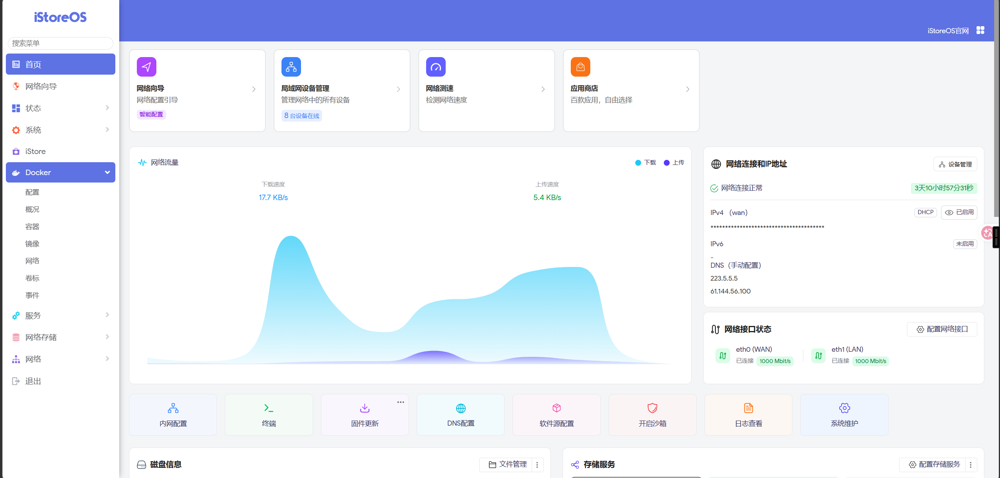
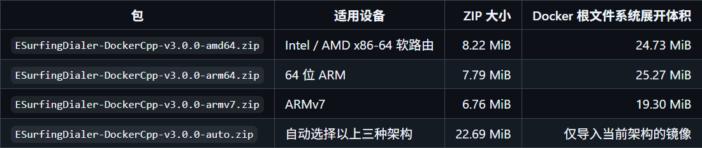
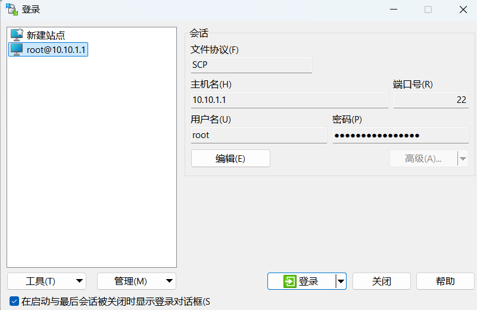
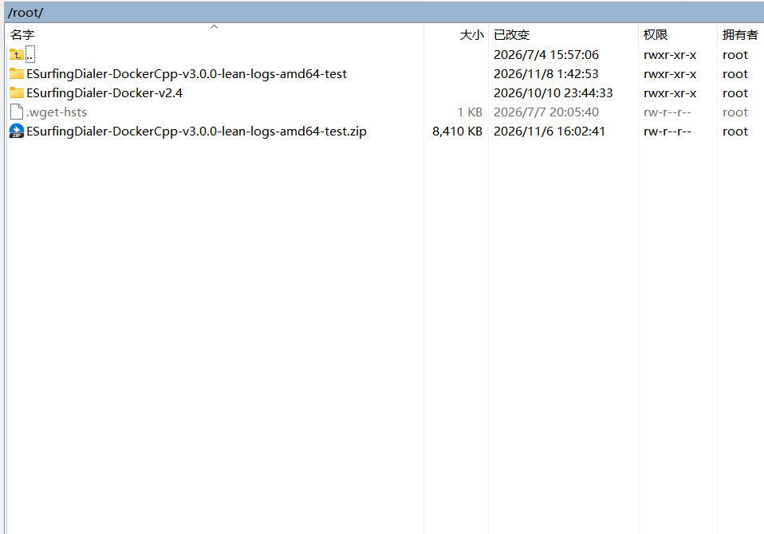
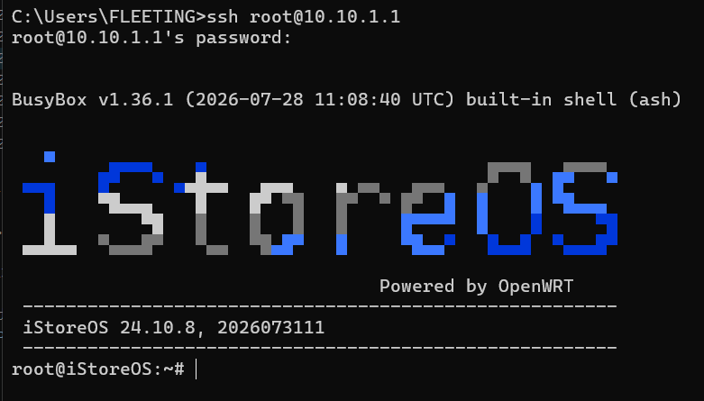
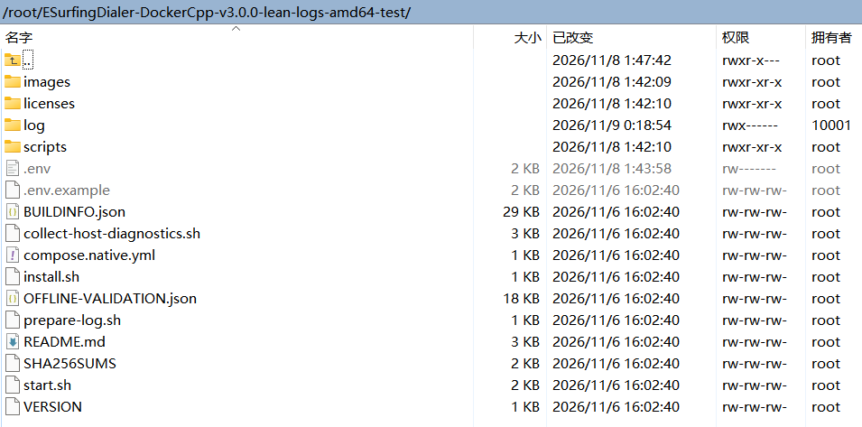
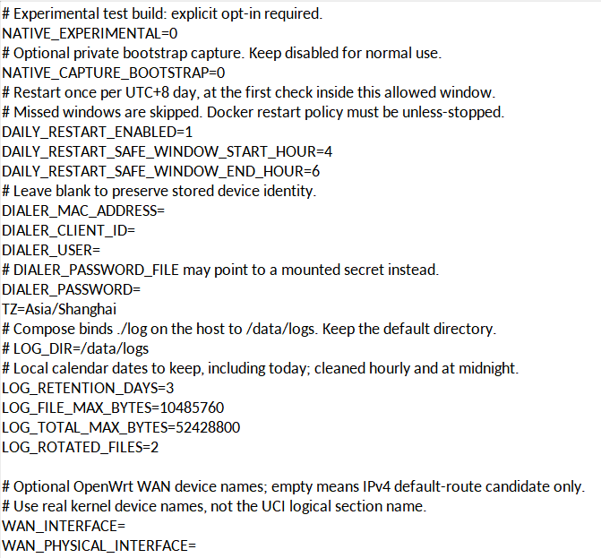
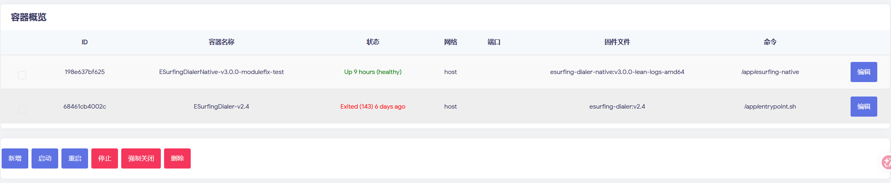

# Docker 新手安装教程

本教程以 **V3.0.0 正式版**为例，后续 Docker 版本也按这套步骤安装；如安装方式发生变化，会更新本教程。旧版本的脚本和配置名称以包内说明为准。

教程截图使用的是 V3.0.0 验证版，与正式版功能一致，只在细节设置上有差异。请保留安装包原有的 `.env` 设置，只填写账号密码，不照着截图修改其他设置。

整体流程：下载安装包 → 上传软路由 → 解压 → 填写账号 → 启动认证。

## 1. 准备环境

准备一台用于运行软路由的主机，以及一台 Windows 电脑。

如果主机还没有安装软路由系统，先参考下面的视频刷入 OpenWrt / iStoreOS：

[OpenWrt / iStoreOS 安装教程（哔哩哔哩）](https://www.bilibili.com/video/BV1w541157Uo/)

已经装好系统的可以跳过。刷入系统后，打开软路由管理页面，安装并启用 Docker 和 Docker Compose。

电脑连接到软路由，记下软路由的管理 IP 和登录密码。

电脑安装 WinSCP，用来上传文件；命令操作使用 Windows 终端。



## 2. 下载安装包

先通过 SSH 查询设备架构。在电脑打开 Windows 终端或 CMD，执行：

```sh
ssh root@192.168.1.1 uname -m
```

把 `192.168.1.1` 换成软路由 IP。首次连接时，核对地址后输入 `yes`，再输入软路由密码；输入密码时屏幕不显示字符。

命令会显示架构，例如 `x86_64`。按下表选择安装包：

| 命令输出 | 选择的包 |
| --- | --- |
| x86_64 / amd64 | amd64 |
| aarch64 / arm64 | arm64 |
| armv7l / armv7 | armv7 |

打开项目的 [Releases 下载页面](https://github.com/FLEETING-XHX/ESurfingDialer/releases)，选择需要的 Docker 版本，下载对应架构的离线部署 ZIP。合集包包含多个架构，由安装脚本自动选择。

下载的是部署包，不是页面底部的 `Source code`。



## 3. 上传到软路由

打开 WinSCP，填写：

| 项目 | 内容 |
| --- | --- |
| 文件协议 | SFTP（连接失败时尝试 SCP） |
| 主机名 | 软路由 IP |
| 端口 | 22 |
| 用户名 | root |
| 密码 | 软路由登录密码 |

登录后，在右侧打开用于存放安装包的目录，将下载好的 ZIP 拖到右侧，等待上传完成。

默认可以使用 `/root`。空间不够时，选择空间充足的已挂载存储目录，例如 `/mnt/sda1`。记下 WinSCP 右侧地址栏中的完整路径，解压时会用到；该位置需要能放下 ZIP 和解压后的文件。






## 4. 连接软路由终端

在电脑打开 Windows 终端或 CMD，输入：

```sh
ssh root@192.168.1.1
```

把 `192.168.1.1` 换成软路由 IP。首次连接时，核对地址后输入 `yes`，再输入软路由密码。输入密码时屏幕不显示字符，输完按回车。



## 5. 解压安装包

先进入刚才上传 ZIP 的目录。如果上传到了 `/root`，输入：

```sh
cd /root
```

如果上传到了其他目录，就换成那个路径。例如上传到了 `/mnt/sda1`：

```sh
cd /mnt/sda1
```

以上两条 `cd` 按实际位置选一条执行。然后查看文件：

```sh
ls
```

找到上传的 ZIP，用它的实际文件名解压：

```sh
unzip 你下载的安装包.zip
```

文件会解压到当前目录，因此只需改前面的 `cd` 路径，`unzip` 后面仍填写实际 ZIP 文件名。

进入解压后的目录：

```sh
cd 解压后的文件夹名
ls -a
```

这里的中文是占位文字，要换成实际名称。目录中应能看到 `install.sh`、`start.sh` 和 `.env.example`。



## 6. 安装并填写账号密码

先停止电脑或软路由上正在运行的旧认证程序，再执行：

```sh
sh install.sh
```

V3.0.0 会导入本地镜像、创建配置文件和容器，**此时不会启动认证**。安装完成后，选择下面一种方式编辑 `.env`。

### 方式一：在 SSH 中编辑

在安装目录执行：

```sh
vi .env
```

按 `i` 进入编辑模式，找到账号和密码，改成自己的信息：

```dotenv
DIALER_USER='你的校园网账号'
DIALER_PASSWORD='你的校园网密码'
```

改完按 `Esc`，输入 `:wq`，按回车保存并退出。

### 方式二：在 WinSCP 中编辑

在 WinSCP 右侧进入安装目录，双击 `.env`，修改 `DIALER_USER` 和 `DIALER_PASSWORD`，然后按 `Ctrl + S` 保存。看不到 `.env` 时，开启“显示隐藏文件”。

两种方式填写的内容相同。普通密码可以使用上面的单引号写法；密码含单引号时，按包内配置说明填写。

保留安装包原有的其他设置，只填写账号密码。旧版本若在安装过程中询问账号密码，按提示输入即可。




## 7. 启动并查看结果

回到刚才的终端，在安装目录执行：

```sh
sh start.sh
```

V3.0.0 查看日志：

```sh
docker compose -f compose.native.yml logs --tail 80
```

看到登录成功提示后，用连接软路由的电脑或手机打开网页，确认能够上网。

持续查看日志可执行：

```sh
docker compose -f compose.native.yml logs -f --tail 80
```

按 `Ctrl + C` 退出日志查看，认证程序继续运行。



## 日常使用

以下命令在安装目录执行。

| 操作 | V3.0.0 命令或方法 |
| --- | --- |
| 停止认证 | `docker compose -f compose.native.yml stop` |
| 再次启动 | `sh start.sh` |
| 修改账号密码 | 编辑 `.env`，保存后执行 `sh start.sh` 应用 |
| 查看最近日志 | `docker compose -f compose.native.yml logs --tail 80` |

更新版本时，先停止旧容器并备份 `.env` 和状态数据，再按新包说明安装。跨版本的数据保留方式见包内 README。

## 遇到问题

| 现象 | 处理方法 |
| --- | --- |
| 找不到文件或脚本 | 用 `pwd`、`ls -a` 确认当前目录 |
| 找不到 `unzip` | 在软路由软件包管理页面安装 `unzip` |
| Docker 或 Compose 不可用 | 在软路由管理页面安装并启用，执行 `docker info`、`docker compose version` 检查 |
| 架构不匹配 | 执行 `uname -m`，下载对应架构的包或合集包 |
| 启动后仍不能上网 | 查看日志中的错误提示，核对账号密码；反馈时附版本号和隐藏账号信息后的日志 |

## 只部署，稍后再启动

V3.0.0 的安装和启动是分开的。在解压后的安装目录执行：

```sh
sh install.sh
```

这会导入镜像并创建容器，**不会启动认证**。填写好 `.env` 后，可以先停在这里。

准备使用时，再执行：

```sh
sh start.sh
```

如果容器已经在运行，先停止它：

```sh
docker compose -f compose.native.yml stop
```

`install.sh` 用于安装，不能代替停止命令。
